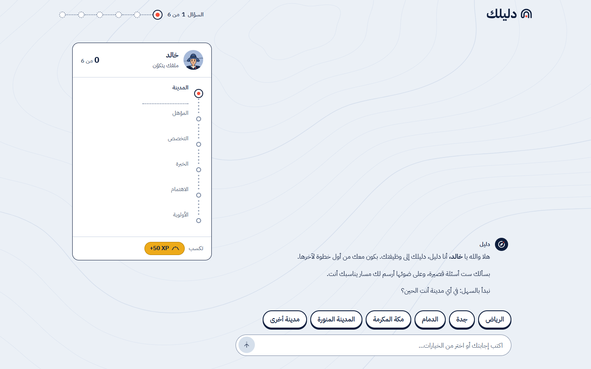
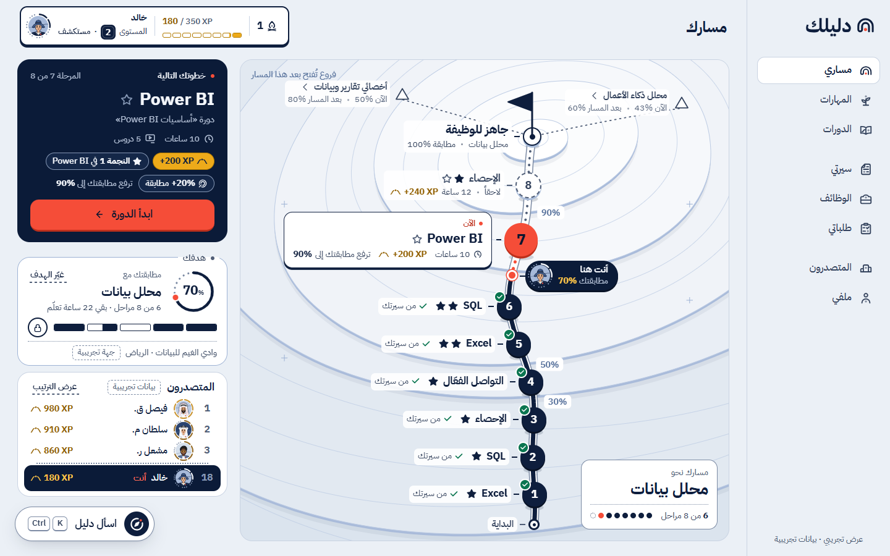
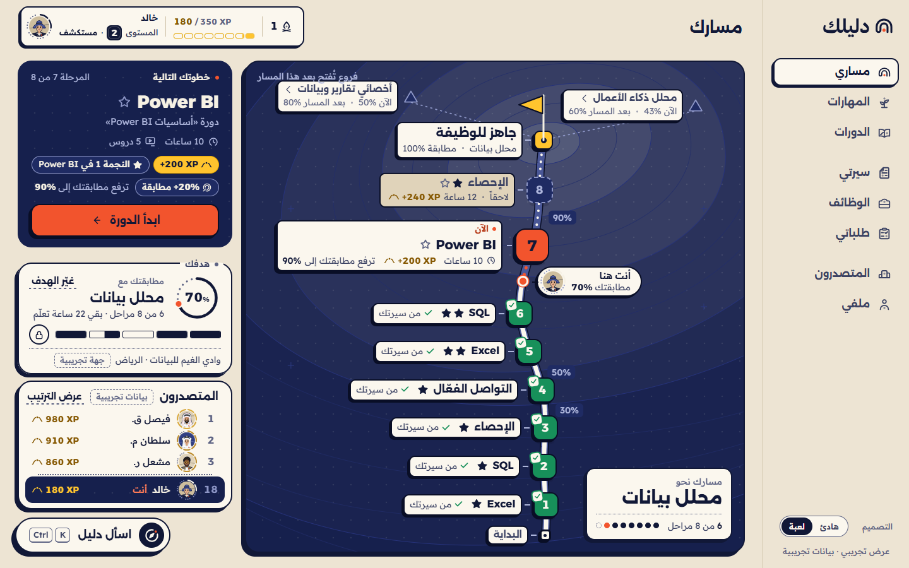
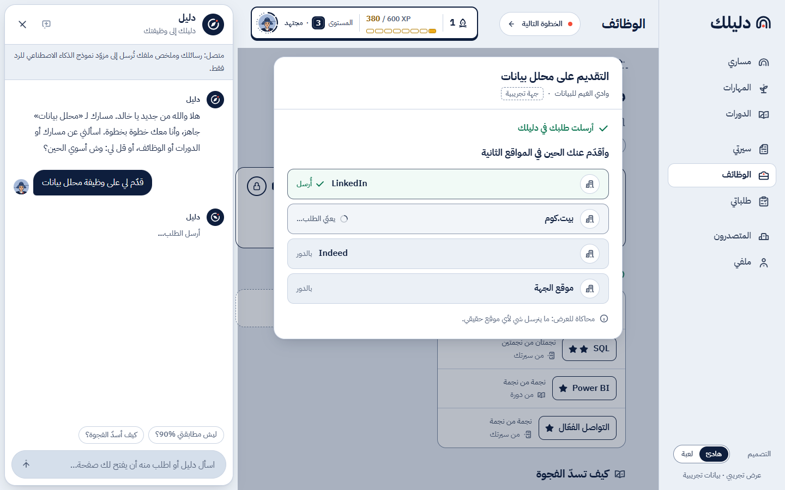

# دليل · Dalilak

**دليلك إلى وظيفتك: from your skills to your job.**

Dalilak is an Arabic, game-like career guide. You talk to «دليلك» ("your guide"), upload your CV, and in seconds you know where
you stand, which job fits you, what you are missing, and the next step. Every course you finish is measured progress toward
the job you chose: XP, levels, stars, badges and a weekly leaderboard.

Built for the Maharah hackathon («مهاراثون»), November 2026.

| Onboarding with «دليلك» | Your roadmap (calm design) |
| --- | --- |
|  |  |
| **Your roadmap (game design)** | **«دليلك» applies for you** |
|  |  |

## What it does

- **A conversation, not a form.** «دليلك» asks six short questions in Saudi Najdi Arabic (city, education, major,
  experience, interests, priority), understands typed answers in dialect, and answers every message at once.
- **CV analysis you can see.** Upload a PDF or Word file, or paste the text. Dalilak finds 38 skills, gives each one 1 to 3
  stars, and shows the sentence in your CV that proves it.
- **Job match and gap.** Every job shows your match, the skills you already have, the ones you are missing, and the courses
  that close the gap.
- **A roadmap you can play.** Your path is a map from «البداية» to the job, with a 3D flight to each station, a skill tree,
  XP, levels, a daily streak, 12 badges and a leaderboard.
- **An advisor that acts.** «دليلك» answers questions about your path, jobs, courses and the platform itself, opens the
  page you need, and can fill an application for you: on a real posting he prepares it and you send it from the original
  posting.
- **Two designs.** A calm design and a game-board design; the user switches between them in the side menu or on «ملفي».
- **Works offline.** With no internet or no AI key, «دليلك» runs on a built-in local brain. With a Gemini key, free
  questions are answered by Gemini, inside rules enforced in code (every number must come from the user's own data).

## Real and simulated

- **Real:** the conversation and its scoring, reading the CV and the evidence for each skill, the match formula, the
  roadmap, XP, levels, streak, badges, the ranking, and «دليلك» opening pages and acting when asked.
- **Real postings and guides:** the jobs are real postings with their source links (except one practice job,
  «محلل بيانات», kept so the demo numbers stay), and the learning guides link to real courses, people and articles.
- **Not real:** the practice job and the other leaderboard players. Nothing on screen labels them, and nothing claims an
  application reached a company: the practice job's application is only saved in «طلباتي». Sign-in is by name only, and
  everything is stored in the browser.

## Run it

Needs Node.js 20.9 or newer (built with Node 24).

```bash
npm install
cp .env.example .env.local   # optional: put a Gemini key after GEMINI_API_KEY=
npm run dev                  # http://localhost:3040
```

- `npm run demo` builds and serves the fast production version on http://localhost:3040.
- Open `http://localhost:3040/?seed=fresh` for a clean start, or any page with `?seed=cv-analysed`, `course-done`,
  `job-ready` and more, to jump to a saved demo state. Add `?theme=lawha` for the game design.
- `npm test` runs the unit tests, and `npm run typecheck` checks the types.
- [`DEMO.md`](DEMO.md) has the 2-minute demo, click by click.

## How it is built

- Next.js 16 (App Router), React 19, TypeScript, Tailwind CSS 4, Motion, Zustand, Base UI.
- IBM Plex Sans Arabic, Alexandria and Readex Pro, self-hosted. A custom icon set, logo and 12 avatars.
- The brain: a deterministic router and templates for everything that must be exact (numbers, applying, opening pages),
  and an optional model (Gemini, or Claude) behind one provider switch for free conversation, with a local fallback.
- CV reading: `unpdf` and `mammoth` on the server; the skill finder is a local analyser, and the model can only add skills
  whose evidence sentence is really in the CV.
- More detail: [`docs/PRODUCT-SPEC.md`](docs/PRODUCT-SPEC.md), [`docs/ARCHITECTURE.md`](docs/ARCHITECTURE.md),
  [`docs/GAME-LAYER.md`](docs/GAME-LAYER.md).
